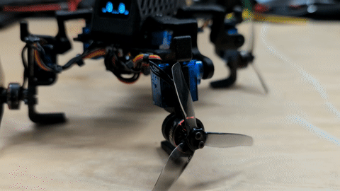
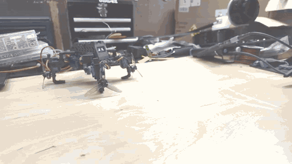
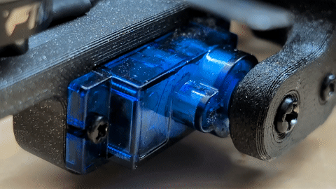
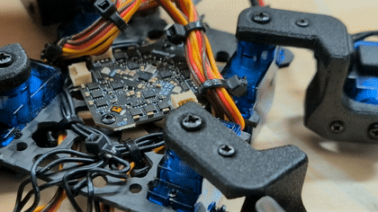

# Sesame Drone
___

___

**Sesame, but it flies.**

Sesame Drone is a version of the [Sesame Robot](https://github.com/dorianborian/sesame-robot) whose legs fold out into propeller arms. It walks somewhere on its legs, folds them out flat against hard end stops, takes off, lands, and walks away again. Four tiny brushless motors ride on the feet, an all-in-one flight controller flies it, and an ESP32 still runs the legs and the face. The whole robot weighs 264 grams.

This repository contains the Fusion 360 CAD, the printable STLs, and the drone fork of the Sesame firmware.

**Full engineering write-up** (the math, the end-stop mechanics, an interactive 3D model you can fold and fly): **[doriantodd.com/projects/sesame-drone](https://www.doriantodd.com/projects/sesame-drone/)**

## Watch the video on YouTube

## Features

*   **Walks and flies:** A regular Sesame gait on the ground, a quadcopter in the air. Land somewhere and walk away.
*   **Folding legs:** Drone mode drives the four knee servos to their midpoint, folding each foot out flat into a propeller arm.
*   **Hard end stops:** Thrust presses each folded leg into a printed stop, so the servos never carry the flight load.
*   **Two independent brains:** An all-in-one flight controller flies it, a Lolin S2 Mini runs the legs and the face. Nothing connects them, so one can fail without taking down the other.
*   **Lightweight build:** SG90 servos instead of MG90S, PPA-CF printed parts, a CNC cut carbon fiber plate, and hex cutouts in the thin shells.
*   **Flight-safe firmware:** A dedicated drone pose, emotes that would swing a leg past its stop removed, and a controller page that locks every input in drone mode until you slide to unlock.
*   **Same face, same app:** The 128x64 OLED face and the Wi-Fi controller page from Sesame, retuned for the drone.

## How it works

**Legs into arms.** Each leg has a hip servo that swings it and a knee servo that rides in the foot, together with a motor and a prop. Standing puts the knees at 0 or 180 degrees, so the feet point straight down. Drone mode moves all four knees to 90 degrees, which folds every foot out flat with its motor on top.

**End stops, not stronger servos.** At hover each motor puts about 18 mN·m on its knee, roughly a tenth of an SG90's stall torque, so strength was never the problem. Stiffness was: hobby servos ignore small errors, plastic gears have backlash, and a drooping arm tilts its thrust. Thrust only ever pushes up, so a one-sided printed stop holds each folded leg rigidly and the servo just has to put it there.

**Two brains.** The walking side is a normal Sesame: the ESP32-S2 drives all eight servos on its eight PWM channels, plus the face and the Wi-Fi controller. There's no PWM left for ESCs, which is one reason the flying side is a separate all-in-one board with its own receiver, IMU and four ESCs.

**Weight.** The target was 250 g and it landed at 264 g. Hover power scales with weight to the 1.5 power, so every gram matters: the same robot with MG90S servos would need about 20% more power just to hover.

The derivations, numbers and diagrams are in the [write-up](https://www.doriantodd.com/projects/sesame-drone/).

---

## Hardware

### CAD

| File | Description |
| --- | --- |
| [Sesame-DRONE-v127.f3z](hardware/CAD/Sesame-DRONE-v127.f3z) | Full Fusion 360 assembly with joints |
| [Sesame-DRONE-v127.step](hardware/CAD/Sesame-DRONE-v127.step) | STEP export for other CAD tools |

### Printed parts

The drone uses its own leg joints, battery carriage and top cover. Joint names match Sesame's servo names, R1 to L4.

| Component | File |
| --- | --- |
| Joint R1 | [DS-R1.stl](hardware/STL/DS-R1.stl) |
| Joint R2 | [DS-R2.stl](hardware/STL/DS-R2.stl) |
| Joint R3 | [DS-R3.stl](hardware/STL/DS-R3.stl) |
| Joint R4 | [DS-R4](hardware/STL/) |
| Joint L1 | [DS-L1.stl](hardware/STL/DS-L1.stl) |
| Joint L2 | [DS-L2](hardware/STL/) |
| Joint L3 | [DS-L3.stl](hardware/STL/DS-L3.stl) |
| Joint L4 | [DS-L4.stl](hardware/STL/DS-L4.stl) |
| Battery carriage | [DS-battery-carriage.stl](hardware/STL/DS-battery-carriage.stl) |
| Ultralight top cover | [DS-ultralight-top-cover.stl](hardware/STL/DS-ultralight-top-cover.stl) |

The internal structure is a carbon fiber plate with hex pockets, cut on a CNC. Its geometry is in the CAD.

**Printing notes**

*   **Material:** PPA-CF (carbon fiber filled high temperature nylon). It's much stiffer than PLA, which matters for arms that must not flex.
*   **Nozzle:** hardened steel. The fiber chews through brass. The spool used here calls for 300 to 320 °C.
*   **Infill:** keep it low on thick parts. Cutting holes in an infilled part can add plastic, because the slicer wraps every hole in a new wall. Hex holes pay off on thin shells that are all wall.
*   **Dry the filament.** Nylon blends absorb moisture quickly.

### Parts list

Everything not listed here follows the [Sesame BOM](https://github.com/dorianborian/sesame-robot/blob/main/hardware/bom/README.md) for the hand-wired Lolin S2 Mini build.

| Item | Qty | Notes |
| --- | --- | --- |
| SG90 micro servo, 180 degree | 8 | Replaces Sesame's MG90S: 9 g instead of about 13 g each, saving about 35 g. Plastic gears, so buy spares. |
| 1104 brushless motor, 7,200 KV | 4 | Mounted on the feet |
| Props, about 3 in (78 mm) | 4 + spares | Matched to the motors, two CW and two CCW |
| BETAFPV F4 2-3S 20A AIO flight controller | 1 | Receiver, IMU and four ESCs on one board |
| 2S LiPo | 1 | Shared by both brains |
| Lolin S2 Mini (ESP32-S2) | 1 | Walking controller, hand-wired as in Sesame |
| 5 V buck converter | 1 | Powers the servos and the S2 Mini from the battery |
| 0.96" SSD1306 I2C OLED | 1 | The face |
| Carbon fiber sheet | 1 | For the internal plate |
| Radio transmitter | 1 | Bound to the flight controller's receiver |

  
  

---

## Firmware

The [firmware](firmware/README.md) is a fork of the Sesame firmware for the walking side. The flight controller runs on its own and doesn't talk to the ESP32.

What's different from Sesame:
*   **Drone pose:** `runDronePose()` stands the robot up, then drives R3, R4, L3 and L4 to 90 degrees to fold the legs out flat.
*   **Culled emotes:** wave, dance, point, cute, freaky, worm and shrug are gone, because each one swings a knee past its midpoint, straight through a prop.
*   **Smoother trot:** the walk cycle uses overlapping diagonal pairs with a slightly longer stride on the front legs.
*   **Sesame Drone Controller:** the captive portal has a drone mode button that locks the whole controller behind a slide-to-unlock interlock.

### Flashing

1.  Install the Arduino IDE and the ESP32 boards package by Espressif.
2.  Install the libraries: `ESP32Servo` **v3.0.9**, `Adafruit SSD1306` and `Adafruit GFX Library`.
3.  Open [`firmware/firmware.ino`](firmware/firmware.ino) with the `.h` files next to it.
4.  Select **LOLIN S2 Mini**, with **USB CDC On Boot** enabled.
5.  Upload, then connect your phone to the `Sesame-Drone-Controller` Wi-Fi network.

> [!IMPORTANT]
> Use **ESP32Servo v3.0.9**. Newer releases have a known issue where writing to one servo can move others ([madhephaestus/ESP32Servo#103](https://github.com/madhephaestus/ESP32Servo/issues/103)).

> [!TIP]
> Change `AP_PASS` in `firmware.ino` from its default before using the robot anywhere public.

Lolin S2 Mini pinout: servos on GPIO `1, 2, 4, 6, 8, 10, 13, 14` (R1, R2, L1, L2, R4, R3, L3, L4), OLED on I2C with SDA `33` and SCL `35`. See the [firmware docs](firmware/README.md) for the API, faces and everything else.

---

## Safety

> [!CAUTION]
> This is a flying robot with exposed props and a LiPo battery. Treat it like any small quad.

*   **Props off on the bench.** Remove them whenever you're working on it, and arm it only in an open space.
*   **The interlock lives in the controller page.** The ESP32 itself still accepts commands from any client. Don't send leg commands while it's flying.
*   **FAA registration.** At 264 g the finished robot is over the 250 g line, so in the US it needs to be registered for recreational flying. Check your local rules.
*   **LiPo care.** Charge with a proper balance charger and don't fly a damaged or puffy pack.

## Status

Sesame Drone is a working prototype. It walks, takes off, hovers and lands, and it has survived a lot of crashes. It also flies with only a little more thrust than weight, so it's hard to fly and doesn't have much margin for corrections. Known rough edges:
*   Very thin thrust margin. More thrust per gram, or less mass, would help most.
*   SG90 gears can strip in a hard landing.
*   The drone mode interlock should move into the firmware.

---

## Related

*   **[Sesame Robot](https://github.com/dorianborian/sesame-robot):** the walking robot this is built on, with build guides, wiring guides and the main firmware.
*   **[Sesame Studio](https://github.com/dorianborian/sesame-studio):** design poses, animations and faces visually.
*   **[Write-up on doriantodd.com](https://www.doriantodd.com/projects/sesame-drone/):** the engineering behind the drone.

## Sponsor

This build was sponsored by **[Makera](https://makerainc.sjv.io/k4J6vn)**. Their Makera Z1 desktop CNC cut the carbon fiber plate that holds everything together.

## Contributing

Pull requests are welcome, especially for:
*   Moving the drone mode interlock into the firmware
*   A flight controller to ESP32 "armed" signal so the legs lock automatically
*   Lighter parts, better motor and prop combinations, and more thrust margin

If you build one, or make your own Sesame fly, come show it off on Discord!

---

*Created by [Dorian Todd](https://www.doriantodd.com/). Need help with your Sesame Drone? Send me a message on Discord, my username is "starphee"*
